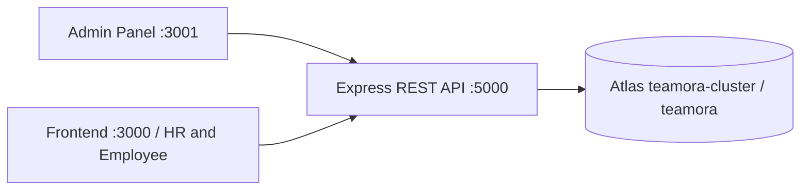

# Architecture

## Exact directories

The existing `Frontend`, `Backend` and `Admin Panel` folders are the three npm workspaces. There is no application wrapper and no Next.js API/backend. Root files coordinate installation and development only.

Both web applications use `NEXT_PUBLIC_API_URL`; browser requests contain a portal header and send HTTP-only cookies. API response shape is `{ data: ... }`; failures are `{ error: { code, message } }`. The canonical public user projection lives in `Backend/src/modules/users/user.model.ts`; the two UI `types/api.ts` files mirror the response contract. No password hash, session version, temporary password or private API key is included in that user projection. Temporary passwords are returned separately once on create/reset, are never saved in plain text, and are never placed in audit logs.

## Security boundaries

The Admin and staff JWTs use different cookie names and JWT audiences. Role authorization always uses the current MongoDB user, never a client-submitted role. Every user/resource query includes the authenticated company ID. Employee reads are further limited to their own ID. Admin controls HR and Employee login activation/reset. HR creates and edits Employee records but cannot reset or deactivate logins, create HR/Admin users, change company settings or read audit history. Admin cannot register or edit employee job details under the PDF's exact functionality matrix; Admin manages only their login status and password.

Protected data routes require completed temporary-password change. `/auth/me`, password change and logout remain accessible to a temporary-password account. Password changes, logout, reset and status changes increment `sessionVersion`; existing JWTs then fail even before their eight-hour expiry. Login/bootstrap/mutations never accept a JWT in browser storage or a query parameter.

Signed double-submit CSRF tokens are fetched from `/auth/csrf`, bound to the portal, stored in HTTP-only cookies and submitted in `X-CSRF-Token`. All unsafe requests including login and setup require them. Browser origins must exactly match the selected portal. CORS credentials are enabled only for the two configured origins. Cross-origin production deployments must use HTTPS, configure cookie `Secure`/`SameSite` appropriately, and use same-site custom domains where possible; third-party cookie policies can block cross-site cookies.

## MongoDB and initialization

The server connects, pings and creates required indexes **before** listening. The database is always `teamora`. Atlas replica-set transactions make company/Admin bootstrap, account creation and audited changes atomic. A unique singleton key prevents simultaneous setup from creating two companies. Users have unique emails and company-scoped unique employee codes. No seed command exists. Index creation requires index-management permissions; alternatively arrange indexes through deployment migrations before tightening the runtime account.

The three current collections are `companies`, `users` and `audits`. Users contain login/profile/job fields in Phase 1; future payroll history will be held separately. `basicSalary` is excluded from normal model selection and only returned by authorized Admin/HR employee-detail reads. Employees cannot change salary, role, name or organization membership through profile routes.

## Audit boundary and remaining work

Routes append audit events for setup, successful login, password change, account creation/update/reset/status changes, organization updates and profile edits. No API can edit or delete audit events; Mongoose update/delete operations are blocked. This is application-enforced append-only history, not a claim that a MongoDB owner cannot tamper with data. Enforce insert/find-only access for `audits` using a dedicated MongoDB role in production. Full sanitized before/after JSON snapshots and the remaining module actions are tracked for Phase 4.

In-memory rate limiting is suitable for one API instance; a shared rate-limit store is required when deploying multiple replicas. Session renewal, email delivery, password recovery by email, SSO and MFA are outside the supplied Phase 1 scope. Admin can use existing credentials to change their password; an initial `.env` password does not override the stored password after setup.

## UI organization

App Router route groups organize auth, HR, Employee, setup and Admin pages. `features` owns feature screens; `components/ui` contains locally editable shadcn-style Button/Input/Card/Badge primitives, `layout` owns session-aware shells, and `services/api.ts` is the sole REST transport. Client route guards provide navigation and loading states; backend authorization is the actual security boundary. Only used feature folders are created. Future modules are documented rather than represented by empty placeholder files.
